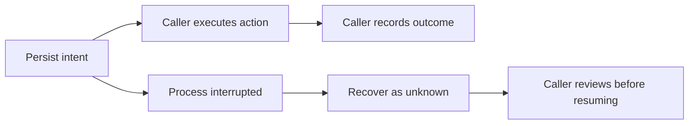

# Onyx engineering

A runnable component from my native Swift macOS assistant prototype: **record an agent’s intent before execution and recover uncertain work without silently repeating it**.

This is a sanitized component showcase, not the full app or an installable assistant. Two reviewed source files and synthetic tests are published with a fresh history. No vault, conversation history, credentials, screen captures, or private research data is included.

## Run

Requires macOS and Xcode Command Line Tools (`swiftc`), with the platform Foundation and CryptoKit frameworks. No package downloads, account, model, permissions, or API key are needed.

```sh
git clone https://github.com/Advaita-G/onyx-engineering.git
cd onyx-engineering
swiftc -warnings-as-errors RunJournal.swift RunJournalTests.swift -o /tmp/onyx-journal-tests
/tmp/onyx-journal-tests
```

Expected: `RunJournalTests: PASS (...)`. Tests use a unique temporary directory and remove it afterward. Keep assertions enabled.

## Implementation

[RunJournal.swift](RunJournal.swift) stores intent, done, failed, cancelled, and unknown states. On recovery an unfinished intent becomes unknown and is reported once. The component does not execute or automatically retry actions.



Storage uses AES-GCM, a separate mode-0600 key file, atomic file replacement, a 50-entry bound, and a 24-hour read window. Labels are bounded and normalized to one line. A stored precondition and age can be checked before resuming.

[RunJournalTests.swift](RunJournalTests.swift) checks encryption round trips, interrupted-step recovery, repeat recovery, precondition mismatch, expiry, bounds, corrupt-file errors, erasure, and key permissions. These synthetic tests passed on 2026-10-20; they do not establish full-app safety.

## Limitations

- This is an educational component, not a security boundary or exactly-once execution guarantee. The caller must record intent before a side effect and interpret unknown outcomes.
- The key sits beside the ciphertext. A process that can read both can decrypt it; encryption does not protect a compromised account.
- The lock coordinates threads in one process. Multi-process locking, symlink hardening, missing/corrupt key recovery, and crash fault injection need more work before sensitive reuse.
- Expiry filters reads, not guaranteed physical deletion. Erasing the journal leaves its key file. A matching precondition does not replace authorization or external-state checks.

## Place in the private app

Onyx separates speech/text input, deterministic commands, typed model routing, action classification, agent execution, and persistent context. The journal sits at the execution boundary.

The full app stays private. Release review found personal material in tracked evidence, privacy defaults inconsistent with older documentation, and best-effort shell restrictions rather than a sandbox. No personal screenshots or private history are reused here.

## Attribution

Developed with Codex and Claude assistance. These files were introduced together in the private project’s journal implementation commit (`010778a`), after its imported baseline. This is not a claim of sole manual authorship or ownership of an upstream assistant. Foundation and CryptoKit are Apple frameworks. Full-app provenance and redistribution review remain outstanding.
